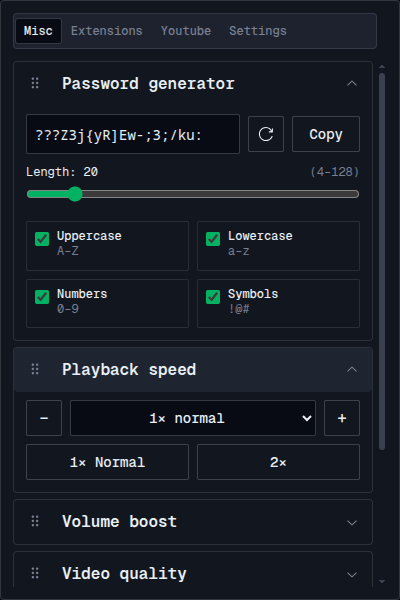
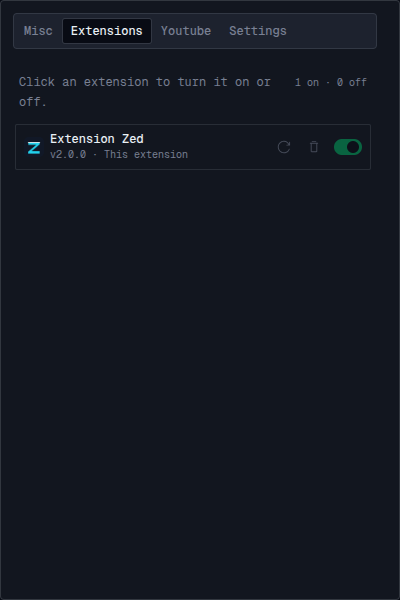
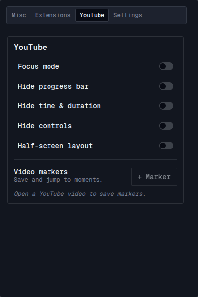
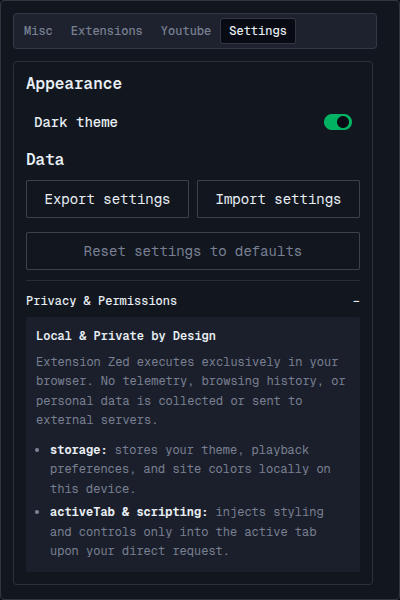

# Extension Zed


Extension Zed is a free browser toolbox for page appearance, video playback, YouTube layout, and extension management. It works in Chrome and Brave.

> **The Chrome Web Store listing is not available yet.** There is no ready-to-install public release archive at this time. The free way to try Extension Zed is to download its source from GitHub, build it once, and load it as an unpacked extension. Developer mode is required; the browser will show its usual warning for unpacked extensions.

## Screenshots

| Misc tools | Extension manager |
| --- | --- |
|  |  |

| YouTube tools | Settings and privacy |
| --- | --- |
|  |  |

The manager does not let Extension Zed modify or uninstall itself. Other installed extensions appear here when present.

## Download and install for free

You need Bun to build the extension from source. Install it from [bun.sh](https://bun.sh/), then follow these steps:

1. Download the [Extension Zed source ZIP](https://github.com/lodaq/extension-zed/archive/refs/heads/main.zip) and extract it. Alternatively, clone the repository with Git:

   ```sh
   git clone https://github.com/lodaq/extension-zed.git
   cd extension-zed
   ```

2. Open a terminal in the extracted `extension-zed-main` folder (or the cloned `extension-zed` folder) and build the extension:

   ```sh
   bun install
   bun run build
   ```

3. Open the extensions page in your browser:
   - Chrome: enter `chrome://extensions` in the address bar.
   - Brave: enter `brave://extensions` in the address bar.

4. Turn on **Developer mode**, choose **Load unpacked**, and select the `dist` folder inside the project folder.
5. Optionally pin Extension Zed from the browser's Extensions menu so it is easy to open.

Keep the selected `dist` folder where it is. To install an update, download the newer source, run `bun install` and `bun run build` again, click **Reload** on Extension Zed's card, and refresh any web pages that were already open.

To create a portable build ZIP yourself, run `bun run package:store`. It creates `artifacts/extension-zed-v2.0.0.zip`; extract that ZIP and use its folder with **Load unpacked**. This command creates a file on your computer, but does not publish or upload it.

## How to use it

- Open Extension Zed by clicking its toolbar icon, or press **Alt+Z**. The tab strip navigation lets you switch between **Misc**, **Extensions**, **YouTube**, **Links**, **Saved**, and **Shortcuts**, plus **Settings**.
- **Misc** contains page and media tools. Open a section or tool tile to use it; changes that are saved as preferences are stored in this browser profile.
- **Extensions** asks for optional management access the first time you use it. Choose **Allow access** and confirm the browser prompt to list and manage other extensions. You can decline and grant it later.
- **YouTube** tools are intended for use while watching a YouTube video. Video markers and layout controls become available when a video is open.
- **Links** organizes quick links and shortcuts to common destinations.
- **Saved** collects bookmarked media links (YouTube videos, Facebook & Instagram reels/posts) and text snippets. You can toggle in-page "Save to Zed" buttons directly on media cards and feed posts, or use the browser right-click context menu to save selections and links.
- **Shortcuts** provides configurable in-page keyboard shortcuts to trigger Zed actions quickly without opening the popup.
- **Settings**, opened with the gear button, controls the theme, supports settings transfer/reset, and includes About with the feature list and overlapping extension alternatives.

## Features

### Popup

- Opens from the toolbar or with **Alt+Z**. The 640 × 600 popup remembers the selected tab and supports mouse-wheel scrolling across its tab strip.
- Page actions show success or error notifications. A failed action also marks its browser tab with an error badge and tooltip; a later successful action clears the warning.

### Misc

- **Screenshots:** capture a selected area, visible area, full page, or element. Full page uses the browser renderer without walking the page in scroll steps. Preview the image, copy it as PNG, download it, or click Edit to send the original PNG to miniPaint’s own tab. Edit requires miniPaint site access and supports PNG files up to about 36 MiB; larger files can be downloaded and opened manually. Locked app shells may briefly render at a taller viewport before restoration. Native full-page capture requires the debugger permission and may show the browser's debugging indicator.

- **Password generator:** create 4–128 character passwords using any combination of uppercase letters, lowercase letters, numbers, and symbols. It uses cryptographic randomness. Copying is always a separate action; generated passwords and generator options are not saved or included in backups.
- **Playback speed:** set video speed from 0.1× to 10×, or use slower, faster, normal, and 2× controls. The preference is saved and reapplied to new videos, when media reloads, and when playback starts.
- **Volume boost:** amplify audio and video from 100% to 2000%. High amplification can distort sound.
- **Video quality:** choose Auto or a preferred resolution from 144p to 4320p, with an option to prefer higher or lower available quality when the exact resolution is unavailable. Uses supported player APIs, including YouTube, Video.js, Shaka, exposed Hls.js players, and native Facebook, Instagram, and TikTok players. Unsupported players keep their own quality setting. A change may briefly buffer.
- **Scrollbars:** hide the document scrollbar, or hide scrollbars throughout the page; the two options can be reset separately.
- **Inspect mode:** hover over page elements to view their identity, position, size, box model, colors, layout, and typography. Press **Escape** to exit an active inspect overlay.
- **Design mode:** temporarily make page content editable. Turning the mode off does not undo edits; reloading the page restores the website.
- **Arabic RTL mode:** adjust Arabic-leading text to read right-to-left, including newly inserted content. Turning it off restores alignment changes made by the extension.
- **Section organization:** collapse sections, drag them into a new order, or focus a section's reorder handle and press Up/Down. The open state and order are saved and included in settings backups.

### YouTube

- Expand the player with **Focus mode** or use a **Half-screen layout**.
- Hide the progress bar and chapters, time and duration, or player controls independently.

YouTube layout preferences are saved in the browser. A YouTube player is needed for the layout controls.

### Extensions

- Open `brave://extensions/` (with fallback to `chrome://extensions/`) in a new tab.
- View installed extensions by name, icon, and version; apps and themes are not listed.
- Click an extension row or use its switch to turn it on or off.
- Open an extension's settings directly using the gear button.
- Reload an extension, or uninstall it through Chrome's confirmation dialog.
- Extensions controlled by browser policy cannot be changed here.

The **Reload** action restarts an extension (for Extension Zed, it reloads the active extension; for other extensions, it restarts the extension to apply updates Chrome has already downloaded).

### Links

- Manage custom links and shortcuts for fast one-click navigation to frequently used destinations.

### Saved

- **Save media:** Automatically mount in-page "Save to Zed" buttons on YouTube video cards, Instagram Reels & posts, and Facebook Reels, posts, and timestamp links. Buttons toggle between Save and Remove states.
- **Save text:** Select any text on a page, right-click, and choose **Save text to Zed** to store it locally with its source page URL.
- **Save links:** Right-click post timestamp links or video URLs and choose **Save link to Zed**.
- **In-page button toggle:** A "Show Save to Zed buttons" switch in the Saved tab lets you hide or show in-page controls without losing saved items.
- **Manage items:** View, copy links, open in new tab, and delete saved items in the Saved tab.

### Shortcuts

- Configure custom keyboard shortcuts for page actions (playback speed changes, volume boost, focus mode, and saving items).
- Shortcuts are intercepted safely by the content script and sync across tabs upon preference change.

### Settings

- The popup uses Zed Dark with keyboard-accessible navigation and focus management.
- Export preferences to a JSON backup, import a backup, or reset preferences.
- Import merges recognized settings; values not present in the backup are left unchanged.

## Privacy and permissions

Preferences and saved items stay in the local browser profile. Extension Zed has no account or cloud sync and does not send telemetry, browsing history, or personal data to an external server. Exported backups include saved website origins along with preferences, so keep backup files private.

The extension needs `scripting`, `activeTab`, `storage`, `clipboardWrite`, `debugger`, `tabs`, and `contextMenus` for page actions, context menu saving, tab navigation, and local preferences. Its automatic playback, video quality, shortcuts, and in-page save features run on HTTP and HTTPS pages, so the browser may show a broad site-access warning. **Management** is optional and is requested only when you choose to use the Extensions tab. Browser-internal and other protected pages generally do not allow page actions. Chrome requires debugger access to be declared at install/update; it cannot be granted as an optional runtime permission. Read [Permissions](PERMISSIONS.md) for details.

Media features depend on the site's player. Some sites may change their player APIs, inaccessible frames may remain unchanged, and unsupported players may not accept speed or quality changes.

## More information

- [Mandatory design system](DESIGN_SYSTEM.md)
- [Full implemented feature inventory](FEATURES.md)
- [Permissions and access rationale](PERMISSIONS.md)
- [Chrome Web Store release status and process](CHROMEWEBSTORE.md)
- [Development and contribution notes](CONTRIBUTING.md)

All UI uses the Zed Dark design system in `src/design-system/`; see DESIGN_SYSTEM.md. No raw colors, radii or font sizes outside tokens.css.
